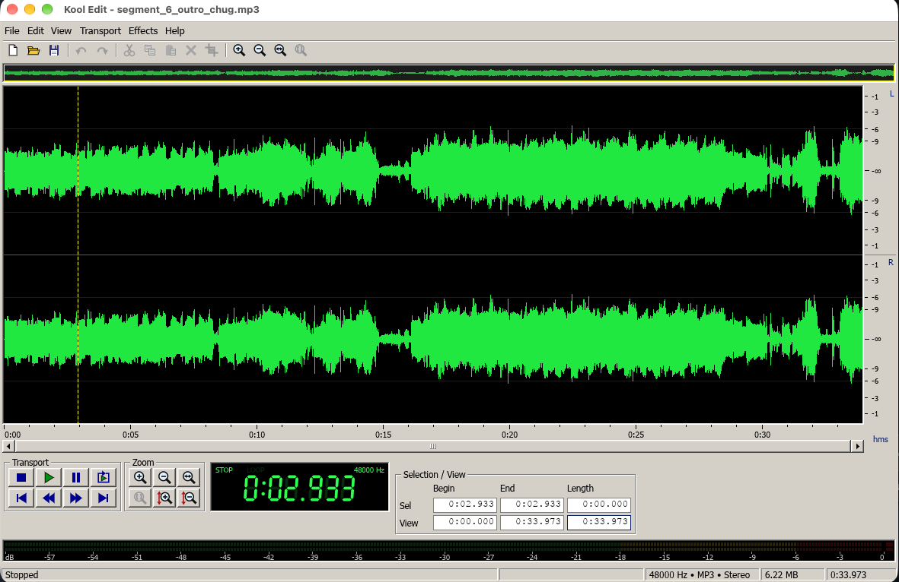

# Kool Edit

A quick and dirty single-track audio editor and player for macOS, built in Rust, that looks and
feels like Cool Edit 96/2000: a black waveform display with a green waveform, a green LCD time
readout, a classic transport, and level meters along the bottom.



One file at a time, no multitrack. Open a file, listen, select, cut/copy/paste/trim, save.

There's also an iPhone and iPad version in [`ios/`](ios/README.md), built for touch, with
recording, markers and sharing a selection.

## Features

- **Opens** WAV, AIFF, MP3, FLAC, Ogg Vorbis, M4A (AAC and ALAC) and CAF (decoded with symphonia).
- **Plays** through the default output device, resampling on the fly if the device runs at a
  different rate. Play / Stop / Pause / Loop, rewind and fast-forward (hold), click to seek
  while playing, and the view follows the playhead.
- **Edits**: Cut, Copy, Paste (inserts at the cursor or replaces the selection), Delete, Trim to
  selection, and unlimited-ish (100 steps) Undo/Redo. The clipboard survives opening another file,
  and pasting converts the sample rate and channel count if needed.
- **Effects** for the selection, or the whole file if nothing is selected: Silence, Fade In, Fade
  Out, Normalize (-0.1 dB), Amplify, Reverse, Invert.
- **Saves** WAV as 16-bit PCM, 24-bit PCM or 32-bit float (File ▸ WAV Format). ⌘S writes back
  in place when you opened a WAV; anything else goes through Save As. You can also save just the
  selection.
- **Views**: a whole-file overview strip, wheel/pinch zoom around the mouse down to individual
  samples, vertical zoom, a dB amplitude ruler, editable Begin/End/Length fields for the
  selection and view, and a status bar with the level under the mouse.
- **macOS integration**: it's a real `.app` with document types, so Finder can open audio files with
  it, double-clicking a file while it's running replaces the current file, and it can make itself
  your default audio player. By default, files start playing as soon as they're opened
  (Transport ▸ Auto-Play on Open).

## Build and run

You need Rust 1.88 or newer.

```sh
git clone https://github.com/Echooff3/kool-edit.git
cd kool-edit
cargo run --release -- path/to/song.mp3
```

## Install it as your audio player

```sh
./scripts/install.sh            # builds "Kool Edit.app", copies it to /Applications, registers it
./scripts/install.sh --default  # ...and makes it the default app for audio files
```

The script installs to `~/Applications` if `/Applications` isn't writable. Once it's installed,
there are three other ways to make it the default:

- In the app, choose **File ▸ Make Default Audio Player**.
- In Finder, select an audio file, press ⌘I, pick Kool Edit under **Open with**, and click
  **Change All…** (do this once per file type).
- Right-click a file, choose **Open With ▸ Kool Edit**.

It registers for MP3, WAV, AIFF/AIFC, FLAC, M4A/AAC, CAF and Ogg. To only build the bundle
(it lands in `target/release/Kool Edit.app`), run `./scripts/bundle.sh`.

## Keyboard and mouse

| Input | Action |
| --- | --- |
| Space | Play / Stop (plays the selection, or from the cursor to the end) |
| P | Pause / Resume |
| L | Toggle loop |
| ← → | Move the cursor (while playing: skip 5 s) |
| ⇧← ⇧→, ⇧Home, ⇧End, ⇧Click | Extend the selection |
| Home / End | Go to the beginning / end |
| Click | Set the cursor (seeks while playing); click the time ruler to scrub |
| Drag | Select; drag a selection edge to adjust it |
| Double / triple-click | Select the visible range / the entire wave |
| Wheel or pinch | Zoom around the mouse (⇧Wheel or a sideways swipe scrolls) |
| = / - | Zoom in / out |
| ⌘0 / ⌘E | Zoom full / zoom to the selection |
| ⌘X ⌘C ⌘V | Cut / Copy / Paste |
| ⌫ | Delete the selection |
| ⌘T | Trim to the selection |
| ⌘A / Esc | Select all / deselect |
| ⌘Z / ⇧⌘Z | Undo / Redo |
| ⌘N ⌘O ⌘S ⇧⌘S | New / Open / Save / Save As |

Drag a file onto the window to open it. Click the level meter to reset the clip lights.

## Limitations

- The whole file is decoded into memory as 32-bit float: about 10 MB per stereo minute
  (roughly 1.3 GB for an hour).
- It saves WAV only (no MP3/AAC encoding).
- Edits always apply to every channel.
- AAC files from some encoders keep their roughly 20 ms of encoder priming silence at the start.
- Opus isn't supported.

## Development

```sh
cargo test                     # edit/undo model, peak cache, WAV round-trips, time parsing
cargo clippy --all-targets
```

The `devtools` feature adds a scripted-input harness that drives the real UI and saves its own
screenshots, which is handy for checking changes without clicking around:

```sh
cargo run --features devtools -- song.wav   # with KOOL_SCRIPT set, e.g.:
KOOL_SCRIPT="wait 30; drag 300 300 600 300; key X cmd; shot /tmp/after-cut.png; quit" \
  cargo run --features devtools -- song.wav
```

See `src/devtools.rs` for the step syntax. `kool-edit --info FILE...` prints what the decoder
sees in each file.

### Layout

| File | Contents |
| --- | --- |
| `src/audio.rs` | Planar samples, the min/max peak cache, effects |
| `src/doc.rs` | The open document, edit operations, undo/redo |
| `src/decode.rs` / `src/wav.rs` | Loading (symphonia) and saving (hound) |
| `src/player.rs` | cpal playback, lock-free transport state, resampling |
| `src/app.rs` | The window: actions, menus, transport, waveform interaction |
| `src/ui/` | The Cool Edit theme, hand-painted widgets, waveform rendering |
| `src/macos.rs` | Finder open events, ⌘Q handling, the default-app registration |
| `macos/Info.plist`, `scripts/` | App bundle metadata, bundle and install scripts |
